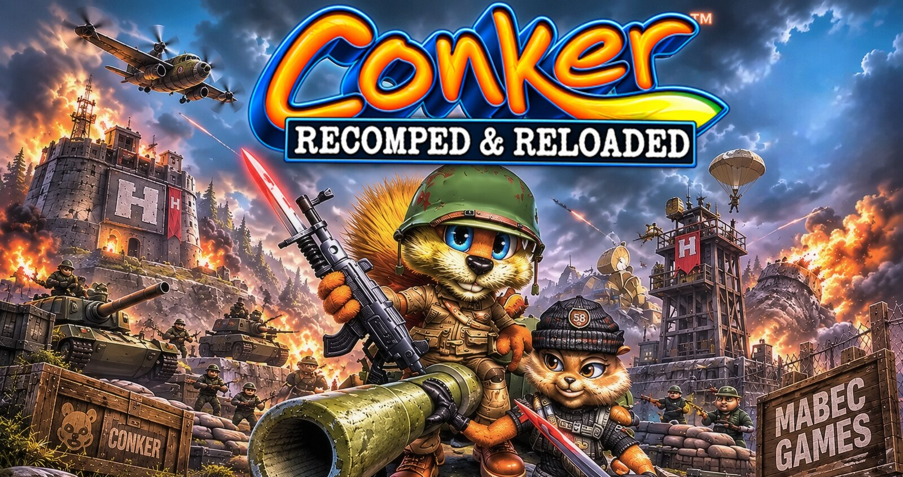
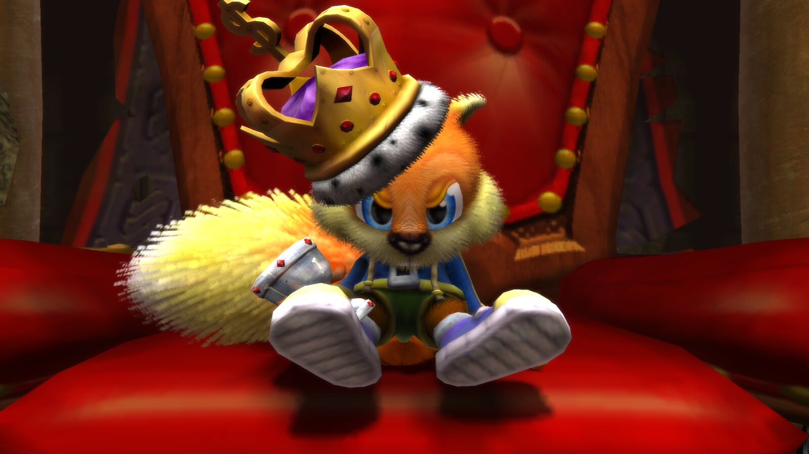
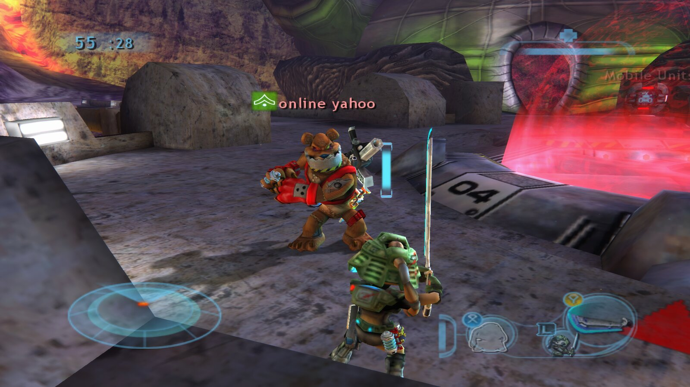
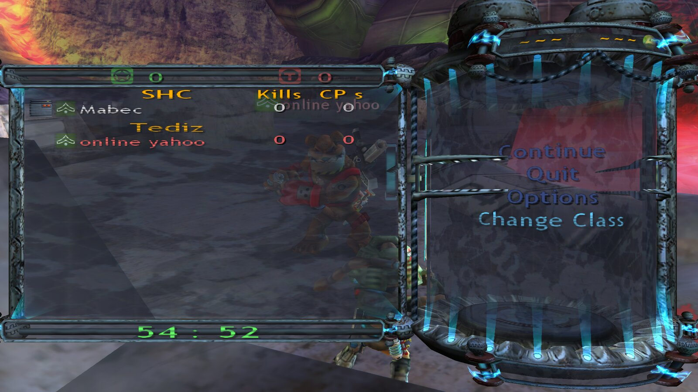

<h3 align="center">Mabec Games presents</h3>

<p align="center">
  
</p>

<p align="center">
  <b>Conker: Live &amp; Reloaded (Xbox, 2005), running natively on Linux and Windows.</b><br>
  A static recompilation with a launcher that builds the game from your own disc, enhanced graphics, and online play
  with room codes.
</p>

<p align="center">
  <a href="#features">Features</a> ·
  <a href="#enhanced-cutscenes">Enhanced cutscenes</a> ·
  <a href="#play-online">Play online</a> ·
  <a href="#install">Install</a> ·
  <a href="#controls">Controls</a> ·
  <a href="#known-limitations">Known limitations</a> ·
  <a href="#credits">Credits</a>
</p>

<p align="center"><b>Version 1.4.1</b> · Linux x86_64 (AppImage) · Windows 10/11 x64 (portable zip) · GPL-3.0</p>

> [!IMPORTANT]
> This is an unofficial, non-commercial fan project. It is not affiliated with or endorsed by Rare, Microsoft or Xbox
> Game Studios. **No part of the game is included.** You build it from your own copy of *Conker: Live & Reloaded*
> (original Xbox, USA or Europe).

## What it is

*Conker: Live & Reloaded* was never released on PC. [**Live & Recompiled**](https://github.com/giacomozama/live-and-recompiled)
by **giacomozama** and **TGP482** changes that: it translates the game's Xbox code into native code that runs directly
on your PC, with a modern Vulkan renderer. There's no emulator.

**Conker: Recomped & Reloaded** is a launcher and a modified build of that port:

- **It builds the game for you.** On the first run you choose your disc image. The launcher extracts it and compiles
  the game on your PC in a few minutes, with the compiler included, so it works offline.
- **Every setting lives in the launcher,** not in menus inside the game: graphics, enhancements, audio, controls,
  online and mods.
- **It adds online play with room codes,** so friends can join your match over the internet.
- **Everything stays in one folder**, next to the AppImage or the launcher's `.exe`. Nothing goes to hidden folders,
  `%APPDATA%`, the registry or system locations.

## Features

**Graphics**
- Native widescreen at any aspect ratio (16:9, 16:10, 21:9, 32:9). Wider screens show more of the scene, with
  nothing stretched.
- Any resolution, fullscreen, borderless or windowed, with internal rendering from 25% to 400% (supersampling).
- 30 (original), 60, 120, 180 or 240 FPS, with V-Sync. Or **Game logic at 30 (original timing)**: the game runs at
  the original 30 and the frames up to 60 or 120 are drawn in between, which avoids 60 fps bugs.
- MSAA up to 8×, SMAA, anisotropic filtering up to 16×, ambient occlusion, plus optional film grain and chromatic
  aberration.
- The game's vignette (its darkened screen edges) can be turned off. The red flash when you're hurt stays.

**Language and sound**
- Play in **English, French, German, Spanish, Italian or Japanese**: menus and subtitles from the disc. The voices are
  English in every language.
- **Cutscene volume:** cutscenes play quieter than the rest of the game; raise them by up to 12 dB.

**Enhancements** (each one can be turned off)
- Per-pixel lighting on characters and objects.
- Softer fur shading, and full fur at a distance.
- Characters and grass at full detail at every distance, and wind on distant grass.
- Dynamic water that ripples as things move through it, and a fix for the blur on reflective floors.
- Rope physics, and **skippable cutscenes**: press LT to skip any cutscene, even ones you haven't seen.

**Controls**
- Xbox, PlayStation and Switch controllers, with rumble and adjustable vibration strength.
- Keyboard and mouse with mouse look, and every key rebindable in the launcher.
- Up to 4 players in split screen on one PC, each with their own devices. Keyboards get a separate key set for
  multiplayer matches.
- **The launcher works with a controller too,** for the Steam Deck's Game Mode or a couch: D-pad and A to change
  settings, LB / RB for the tabs, Start to play. On a small screen it scales itself up (Launcher → Launcher size).

**Online**
- Host a room and share a **6-word room code**. Friends join over the internet without typing any IP address. See
  [Play online](#play-online).

**And also**
- **No in-game menus:** on the main menu, Esc / Start / Back ask *"Quit the game?"* with **Yes / No**.
- **No more Xbox Live hang:** the dead Xbox Live sign-in can't be opened by accident.
- **Optional decensor mod:** the [decensor mod](https://github.com/nastys/conker-live-and-reloaded-decensor) is
  downloaded from its authors' latest release, checked against GitHub's checksum, and applied without touching your
  disc image. It's off by default. Its subtitles are uncensored in English, French, Italian and Spanish; its audio is
  a work in progress (so far the Great Mighty Poo song and the Greg, Uga Buga, Spooky and Windy cutscenes).
- **Logs you can share:** the game's logs never contain IP addresses.

## Enhanced cutscenes

<p align="center">
  
</p>

Cutscenes play at your resolution and frame rate, with the fur shading and per-pixel lighting enhancements. Turn on
*Skippable cutscenes* to skip any of them with LT.

## Play online

<p align="center">
  
  
</p>

The game's own **System Link** mode, which was LAN only on the Xbox, now works over the internet. There's no server in
between.

**Host:** in the launcher's **Multiplayer** tab, choose **Host a room**. The launcher asks your router to open UDP port
3074 (UPnP) and shows a 6-word code such as `ELFISHLY-NINTENDO-SKULK-HUBCAP-ALMANAC-OLYMPICS`. Copy it to your friends,
press **Play**, then choose **Multiplayer → Online Play → Host** in the game.

**Join:** choose **Join a room**, paste the code, press **Play**, then choose **Multiplayer → Online Play → Play** and
pick the host's match.

**On the same network:** choose **This network only**. No code is needed, because games are found automatically.

**How it works**
- **What's in the code:** the host's public address, scrambled with a random 20-bit **room key**, plus a checksum.
  The key is new every time you host, or when you press **New code**, so the same address never gives the same code.
- **The key is enforced by the game:** the host's game only accepts players from the internet who have this room's
  key. An old or leaked code stops working as soon as the host makes a new one, and players on a different version
  are refused cleanly. Players on the host's own network don't need the key.
- **Typos:** each word is identified by its first three letters, so small typos still work, and a wrong word is caught
  99.8% of the time.
- **If your router doesn't support UPnP:** the launcher tells you, and shows what to forward by hand (UDP 3074 to your
  PC). If your PC has a firewall, allow UDP 3074 too.
- **Privacy:** the code is scrambled, not encrypted. It keeps your IP off your screen and out of chat logs, but the
  players you invite connect to your IP and can see it, as in any peer-to-peer game. Share codes with people you trust.
- **If you can't host from your connection:** some providers share one public address between customers (CGNAT), and
  the launcher warns about it. A virtual LAN such as Tailscale or ZeroTier works instead: enter the host's VPN address
  under *Advanced*.

**Tested so far:** 2 players on two PCs, connected over the internet with a room code. The game's lobby allows up to 16
players, but **3 or more online players haven't been tested yet.** If you try it, the game log
(`game/logs/game.log`) reports traffic every 30 seconds and refused players, without any addresses. Please share those
lines.

**Hosting many players:** as a rough guide, from Xbox-era games rather than measurements, plan on about 100–200 kbit/s
of **upload** per player you host. That's 1.5–3 Mbit/s for 15 players. A wired connection and players close to you
matter more than raw speed.

Everyone in a match needs **the same version** of Conker: Recomped & Reloaded.

## Install

**You need:**
- **Your own disc image:** *Conker: Live & Reloaded* for the original Xbox, **USA or Europe** release, as an `.iso`.
  Its `default.xbe` has SHA-1 `2232a1b3874d67b4bb4cf53a940420d2dab59535` (USA) or
  `68a37f0d03d73dabc86a848df5ec1820dd551254` (Europe), and the launcher checks it for you. Both discs hold the same
  game (only the `default.xbe` header differs), so they build the same game: mods work the same, and players with
  either disc can play online together.
- **Linux:** x86_64 with **glibc 2.34 or newer** (Debian 12, Ubuntu 22.04, Fedora 35, current Arch, Bazzite and
  newer), and FUSE 3 (`fusermount3`), which is standard on current desktops.
- **Windows:** Windows 10 or 11, 64-bit.
- **A GPU with Vulkan 1.3**, and about 8 GB free while setting up (about 5 GB afterwards). Older Intel integrated
  graphics (UHD/HD 600 series) don't work: see [Known limitations](#known-limitations).
- **A controller is recommended** for multiplayer menus (see [Controls](#controls)).

Download from [Releases](https://github.com/Mabec-games/Conker-Recomped-and-Reloaded/releases).

**Linux**
1. Put `ConkerRecompedReloaded-x86_64.AppImage` in a folder of its own, for example `~/Games/ConkerRecompedReloaded/`.
   Everything the game creates will live next to it.
2. Make it executable (`chmod +x ConkerRecompedReloaded-x86_64.AppImage`, or tick *Allow executing* in its
   properties), then run it.

**Windows**
1. Extract `ConkerRecompedReloaded-windows-x64.zip` to a folder of your own, for example
   `C:\Games\ConkerRecompedReloaded\`, not *Program Files*, since the launcher writes next to itself.
2. Run `ConkerLauncher.exe`. The launcher isn't code-signed, so Windows SmartScreen may warn the first time: choose
   **More info → Run anyway**.

**Then, on both:**
3. Choose your disc image and press **Install**. The launcher checks the disc, extracts it and builds the game, which
   takes a few minutes. Nothing is downloaded: the compiler comes with the launcher.
4. Press **PLAY**. The disc image is no longer needed.

**The folder afterwards:**
```
ConkerRecompedReloaded-x86_64.AppImage   (on Windows: ConkerLauncher.exe and its files)
launcher.ini          the launcher's preferences
game/                 the built game, settings.toml, saves (hdd/), logs/, shader caches, assets/ (your disc's files)
mods/                 the decensor mod, when turned on
```

Moving or deleting that one folder moves or removes everything. `--play` starts the game straight away, which is
handy for a desktop shortcut.

**Updating:** replace the AppImage (on Windows, extract the new zip over the old folder). When a new version brings
new game code, the launcher offers to rebuild the game on its next start. That takes a few minutes, works offline,
and keeps your settings and saves.

## Controls

A controller works out of the box. On a keyboard, the default keys are:

| Controller | Key | Controller | Key |
|---|---|---|---|
| Left stick | W A S D | Right stick (camera) | mouse, or arrow keys |
| **A** (jump, confirm) | **Space** | **B** (back, cancel) | **E** or right mouse button |
| X | R | Y | Tab |
| LB (white) | T | RB (black) | K |
| LT | Q or middle mouse button | RT (fire) | Left Ctrl or left mouse button |
| Start (pause) | Enter or Esc | Back | Backspace |
| D-pad | 1 2 3 4 | Stick clicks | Left Shift, Left Alt |

Rebind any of them in **Controls**, separately for single player and multiplayer matches.

## Known limitations

- **Keyboard in multiplayer menus:** some screens (class or team selection) don't respond to mouse clicks, and the
  on-screen hints show controller buttons. Use Space for A and E for B, or a controller.
- **Instant death on the barn roof (Barn Boys) with 60 fps game logic:** a known upstream bug
  ([#1](https://github.com/Mabec-games/Conker-Recomped-and-Reloaded/issues/1),
  [live-and-recompiled#2](https://github.com/giacomozama/live-and-recompiled/issues/2)). Tick Graphics → **Game
  logic at 30 (original timing)** for that part: the game runs at the original 30 while 60 or 120 frames a second
  are still shown, and Conker survives the roof.
- **Older Intel integrated graphics (UHD/HD 600 series, 6th to 10th gen Core, such as UHD 630) don't work on
  Windows:** the game builds, but closes right away with code -1073741819. Intel's driver for these GPUs crashes on
  the first frame inside its own code (in dynamic rendering, a Vulkan 1.3 feature it claims to support). It isn't your
  disc or your install, and the upstream port has the same crash
  ([#14](https://github.com/Mabec-games/Conker-Recomped-and-Reloaded/issues/14),
  [live-and-recompiled#8](https://github.com/giacomozama/live-and-recompiled/issues/8)). These GPUs would also be too
  slow for the game. A dedicated GPU, or newer integrated graphics (Intel Iris Xe or Arc, AMD Radeon), works.
- **3+ online players:** untested so far (see [Play online](#play-online)).
- **Windows is new:** the launcher, the bundled compiler and the build kit pass automated tests on Windows, but full
  installs have been played on Linux so far. Reports from Windows players are very welcome.
- **When hosting on Windows:** Windows Defender Firewall asks whether the game may use the network the first time.
  Allow it on private networks, or friends can't connect.
- **Supported discs:** the USA and Europe disc images only.

## Reporting bugs

Open an [issue](https://github.com/Mabec-games/Conker-Recomped-and-Reloaded/issues) and include:

- what happened and where (chapter and area), and whether it happens every time
- a video or screenshot if you can
- your system: Linux distribution or Windows version, and your graphics card
- your launcher settings, especially **Frame rate**: some bugs only happen at 60 fps and above, so please say
  whether the bug still happens at 30
- the game's log

Everything stays in the folder you installed into, on both Linux and Windows:

| What | Where |
|---|---|
| Game log | `game/logs/game.log` |
| Crash dumps (if the game crashed) | `game/CrashDumps/` |
| Game settings | `game/settings.toml` |
| Launcher settings | `launcher.ini` |

On Windows, the same paths use backslashes (`game\logs\game.log`).

**Copy the log before you start the game again:** each start replaces it. The log has no IP addresses, but it
does show the folder the game is installed in, which can include your user name. Edit that out before attaching
if you like.

## Building from source

```sh
git clone --recurse-submodules https://github.com/Mabec-games/Conker-Recomped-and-Reloaded
cd Conker-Recomped-and-Reloaded
# the game's build kit, from the live-and-recompiled submodule (launcher branch); it needs your extracted disc in
# live-and-recompiled/assets/ (see that project's BUILDING.md)
(cd live-and-recompiled && tools/package.sh)
# the launcher (Qt 6 Widgets and Network, libarchive; toml++ and miniupnpc are fetched by CMake)
cmake -S . -B build -G Ninja -DCMAKE_BUILD_TYPE=Release && cmake --build build
tools/make-appimage.sh      # dist/ConkerRecompedReloaded-x86_64.AppImage, with the compiler and licences inside
```

On Windows (Visual Studio 2022, Qt 6 for MSVC, vcpkg): `tools\make-windows.ps1 -Kit <folder with setup-windows.exe>`
makes `dist\ConkerRecompedReloaded-windows-x64.zip`. The release builds come from GitHub Actions
(`.github/workflows/build.yml`): the AppImage is built on Ubuntu 22.04, the zip on Windows, and both are smoke-tested
on Debian 12, Ubuntu 22.04 and 24.04, Fedora 44, Arch and Windows before they're attached to a release. The build
kits they include come from the `kit-*` releases of the game fork, since making a kit needs the disc.

Tests: `tests/online_tool codes` (room codes), and `tests/xnet_wire_test.cpp` in the submodule (the online packet rules).

## Credits

This rests on the work of many people. Thank you all.

| | |
|---|---|
| **Live & Recompiled**, the native port | **giacomozama**, with **TGP482**: [giacomozama/live-and-recompiled](https://github.com/giacomozama/live-and-recompiled) |
| **Xbox XBE Recomp**, the recompiler and runtime | **TGP482**, with Joshhhuaaa: [TGP482/XboxXBERecomp](https://github.com/TGP482/XboxXBERecomp) |
| **Decensor mod** | **nastys** (Italian, French), **Vaani** (English), **Theconker64** (Spanish): [nastys/conker-live-and-reloaded-decensor](https://github.com/nastys/conker-live-and-reloaded-decensor) |
| References for the Xbox hardware | [xemu](https://xemu.app) and [Cxbx-Reloaded](https://github.com/Cxbx-Reloaded/Cxbx-Reloaded) |
| Information about the game's code | the [ConkerXbox60FPSWidescreen patch](https://www.moddb.com/downloads/conkerxbox60fpswidescreen) |
| Launcher, online rooms, AppImage, artwork | **Mabec Games** |
| *Conker: Live & Reloaded* | Rare / Microsoft Game Studios |

The launcher is built with Qt 6, libarchive, toml++ and miniupnpc. It ships the Zig compiler (with LLVM) to build the
game, uses the EFF Short Wordlist for room codes, and is packaged with linuxdeploy. Every project, author and licence
is listed in [CREDITS.md](CREDITS.md), and the full licence texts are in the launcher (*Launcher → About and credits →
Licence texts*).

**Source:** the launcher is this repository (GPL-3.0). The game it builds is
[Mabec-games/live-and-recompiled](https://github.com/Mabec-games/live-and-recompiled/tree/launcher), branch
`launcher` (GPL-3.0), included here as a submodule.

## Legal

*Conker*, *Conker: Live & Reloaded* and *Xbox* are trademarks of their respective owners. This project contains no
game code or assets, and you must use your own legally obtained copy. It's offered as is, without warranty, under the
[GPL-3.0](LICENSE).
